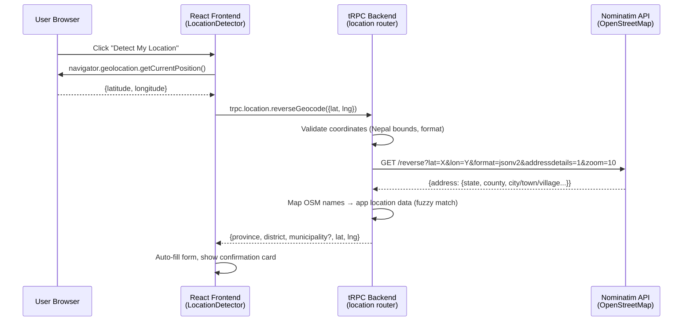

# Design Document: Location Detection

## Overview

This feature adds GPS-based location detection to the report submission form's Location step (step 3). It provides an alternative to the existing manual Province → District → Municipality cascading dropdowns by allowing users to auto-detect their position via the browser Geolocation API, reverse geocode the coordinates to Nepal administrative divisions using the OpenStreetMap Nominatim API, and store the GPS coordinates alongside the report.

**Key Design Decisions:**

1. **Nominatim for reverse geocoding** — Free, no API key required, good Nepal coverage via OpenStreetMap data. The backend proxies requests to avoid CORS issues and implements a mapping layer to normalize OSM address data to our hardcoded province/district/municipality names.
2. **Backend proxy endpoint** — A new tRPC procedure handles coordinate validation, Nepal boundary checking, Nominatim API calls, and name-matching against the app's location data arrays.
3. **No coordinate boundary data in DB** — We rely on Nominatim for geocoding rather than storing polygon/boundary data locally. The existing `provinces`, `districts`, `municipalities` tables are used only for name-matching validation.
4. **Decimal fields on reports table** — Two new nullable decimal columns (`latitude`, `longitude`) store coordinates when available.

## Architecture



The frontend component manages two modes (manual/detect) and coordinates state. The backend handles all external API communication and name resolution.

## Components and Interfaces

### Frontend Components

#### `LocationDetector` (new component)

A self-contained component rendered within the Location step that manages:
- Mode toggle state (manual vs detect)
- Geolocation API interaction
- Loading/error states
- Confirmation card display

```typescript
// src/components/LocationDetector.tsx
interface LocationDetectorProps {
  onLocationDetected: (result: DetectedLocation) => void;
  onModeChange: (mode: "manual" | "detect") => void;
  onClearCoordinates: () => void;
  currentMode: "manual" | "detect";
  detectedLocation: DetectedLocation | null;
}

interface DetectedLocation {
  latitude: number;
  longitude: number;
  province: string;
  district: string;
  municipality: string | null;
}
```

#### `ConfirmationCard` (new sub-component)

Displays the detected location with formatted coordinates and action buttons.

```typescript
interface ConfirmationCardProps {
  location: DetectedLocation;
  onEditManually: () => void;
  onDetectAgain: () => void;
}
```

### Backend Procedures

#### `location.reverseGeocode` (new tRPC procedure)

```typescript
// api/location-router.ts
import { z } from "zod";
import { createRouter, publicQuery } from "./middleware";

const reverseGeocodeInput = z.object({
  latitude: z.number().min(-90).max(90),
  longitude: z.number().min(-180).max(180),
});

const reverseGeocodeOutput = z.object({
  province: z.string(),
  district: z.string(),
  municipality: z.string().nullable(),
  latitude: z.number(),
  longitude: z.number(),
});
```

**Validation rules:**
1. Latitude must be numeric, between -90 and 90
2. Longitude must be numeric, between -180 and 180
3. Precision limited to 6 decimal places (validated via string check before parsing)
4. Nepal boundary check: lat 26.3–30.5, lng 80.0–88.2

**Name-matching logic:**

The Nominatim API returns OSM-tagged address components. For Nepal, the relevant fields are:
- `state` → maps to Province (e.g., "Bagmati Province" or "Province No. 3")
- `state_district` or `county` → maps to District
- `city`, `town`, `village`, `municipality` → maps to Municipality

The backend uses a fuzzy-matching function to resolve OSM names to the app's hardcoded location arrays:

```typescript
function findBestMatch(osmName: string, candidates: string[]): string | null {
  // Exact match first
  const exact = candidates.find(c => c.toLowerCase() === osmName.toLowerCase());
  if (exact) return exact;
  
  // Partial/contains match
  const partial = candidates.find(c => 
    c.toLowerCase().includes(osmName.toLowerCase()) ||
    osmName.toLowerCase().includes(c.toLowerCase())
  );
  return partial || null;
}
```

### Integration with Existing Report Form

The `Report.tsx` page's step 2 (Location) section will be modified to:
1. Add a mode toggle above the existing dropdowns
2. Conditionally render either the dropdowns or the `LocationDetector` component
3. Store `latitude` and `longitude` in the form data
4. Pass coordinates to the `report.create` mutation

### Updated `report.create` Input Schema

```typescript
// Added fields to the existing create mutation input:
latitude: z.number().min(26.3).max(30.5).nullable().optional(),
longitude: z.number().min(80.0).max(88.2).nullable().optional(),
```

## Data Models

### Database Migration: Add coordinates to reports table

```sql
ALTER TABLE reports 
  ADD COLUMN latitude DECIMAL(10, 7) NULL,
  ADD COLUMN longitude DECIMAL(10, 7) NULL;
```

Drizzle schema addition:

```typescript
// In db/schema.ts, add to reports table definition:
latitude: decimal("latitude", { precision: 10, scale: 7 }),
longitude: decimal("longitude", { precision: 10, scale: 7 }),
```

### Form Data Extension

```typescript
// Extended ReportFormData type
type ReportFormData = {
  // ... existing fields ...
  latitude?: number | null;
  longitude?: number | null;
};
```

### Nominatim Response Shape (external)

```typescript
interface NominatimReverseResponse {
  place_id: string;
  licence: string;
  osm_type: string;
  osm_id: string;
  lat: string;
  lon: string;
  display_name: string;
  address: {
    state?: string;
    state_district?: string;
    county?: string;
    city?: string;
    town?: string;
    village?: string;
    municipality?: string;
    suburb?: string;
    country?: string;
    country_code?: string;
  };
}
```

## Correctness Properties

*A property is a characteristic or behavior that should hold true across all valid executions of a system — essentially, a formal statement about what the system should do. Properties serve as the bridge between human-readable specifications and machine-verifiable correctness guarantees.*

### Property 1: Mode switch preserves manual selections

*For any* valid Province/District/Municipality selection made in manual mode, switching to "Detect My Location" mode and back to "Manual Selection" mode should restore the exact same Province, District, and Municipality values.

**Validates: Requirements 1.5**

### Property 2: Valid coordinates forwarded to reverse geocoder

*For any* latitude in [-90, 90] and longitude in [-180, 180] returned by the Geolocation API, the Location_Detector should invoke the reverse geocode procedure with those exact coordinate values unchanged.

**Validates: Requirements 2.3**

### Property 3: Nepal boundary validation rejects out-of-bounds coordinates

*For any* coordinate pair where latitude is outside [26.3, 30.5] or longitude is outside [80.0, 88.2], the reverse geocode endpoint should return an error indicating the location is outside Nepal, and the report submission should store null for both latitude and longitude.

**Validates: Requirements 3.2, 4.5**

### Property 4: Invalid coordinate format validation

*For any* input where latitude or longitude is missing, non-numeric, or has more than 6 decimal places, the reverse geocode endpoint should return a validation error without making any external API call.

**Validates: Requirements 3.5**

### Property 5: Coordinate pair integrity invariant

*For any* report record in the database, the latitude and longitude fields must both be null or both be non-null — partial coordinate storage is never permitted.

**Validates: Requirements 4.2**

### Property 6: Coordinate display formatting

*For any* detected latitude and longitude values, the confirmation card should display them formatted to exactly 4 decimal places.

**Validates: Requirements 5.2**

### Property 7: Manual override clears stored coordinates

*For any* successfully detected location state, when the user switches to manual mode and changes any one of the Province, District, or Municipality dropdown values, the stored latitude and longitude should be cleared (set to null).

**Validates: Requirements 6.4**

## Error Handling

| Scenario | Frontend Behavior | Backend Behavior |
|----------|------------------|-----------------|
| Geolocation permission denied | Display error: "Location access denied. Please allow location access in browser settings or use manual selection." | N/A |
| Geolocation timeout (10s) | Display error: "Location detection failed. Please try again or use manual selection." | N/A |
| Geolocation API not supported | Hide "Detect My Location" button entirely, default to manual | N/A |
| Coordinates outside Nepal | Display error: "Detected location is outside Nepal. Please use manual selection." | Return `OUTSIDE_NEPAL` error code |
| Invalid coordinate format | N/A (frontend always sends valid decimals from Geolocation API) | Return `INVALID_COORDINATES` error with message |
| Nominatim API timeout (5s) | Display error: "Location service temporarily unavailable. Please try again or use manual selection." | Timeout after 5s, return `SERVICE_UNAVAILABLE` |
| Nominatim returns no match | Display partial result with municipality dropdown | Return partial result (province + district, municipality: null) |
| Name-matching failure | Display error: "Could not determine your exact location. Please use manual selection." | Return `MATCH_FAILED` error when no province/district can be resolved |

**Error recovery pattern:** All error states show a "Try Again" option that clears the error and re-initiates detection, plus always allow fallback to manual selection.

## Testing Strategy

### Unit Tests (Example-based)

- Mode toggle renders correctly in default state (1.1–1.4)
- Geolocation API called with correct parameters (2.1)
- Loading state during detection (2.2)
- Error messages for permission denied, timeout, unsupported browser (2.4–2.6, 2.8)
- Confirmation card displays correct data (5.1, 5.3–5.5)
- Form validation with detected location (6.1–6.3)
- Name-matching function handles exact and partial matches

### Property-Based Tests

Property-based testing is appropriate for this feature because several acceptance criteria involve universal properties over varying inputs (coordinate validation, boundary checking, state management invariants).

**Library:** fast-check (already compatible with vitest)

**Configuration:** Minimum 100 iterations per property test.

**Tag format:** `Feature: location-detection, Property {number}: {property_text}`

Tests to implement:
1. **Property 1:** Generate random province/district/municipality tuples, simulate mode switch round-trip, verify restoration
2. **Property 2:** Generate random valid lat/lng pairs, verify they're forwarded unchanged to the backend call
3. **Property 3:** Generate coordinates outside Nepal bounds, verify error response and null storage
4. **Property 4:** Generate invalid coordinate inputs (non-numeric, excessive precision), verify validation error
5. **Property 5:** After any sequence of report submissions, verify the pair invariant holds on all stored records
6. **Property 6:** Generate random decimal coordinates, verify `toFixed(4)` formatting
7. **Property 7:** Generate random detected states + random dropdown changes, verify coordinates clear

### Integration Tests

- End-to-end flow: detect → reverse geocode → form fill → submit → verify stored coordinates
- Nominatim API integration (using real API with known Kathmandu coordinates)
- Database migration verification (columns exist with correct types)

### Edge Cases to Cover

- Coordinates on exact Nepal boundary edges (26.3, 30.5, 80.0, 88.2)
- Municipality not found in Nominatim response (partial result flow)
- Rapid mode switching during pending detection
- Multiple "Detect Again" clicks in quick succession
- Very high precision coordinates (>6 decimal places)
